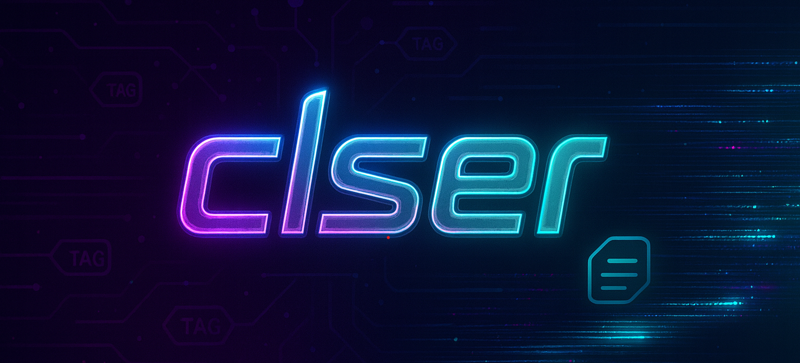

## 介绍

基于 Transformers 的小模型训练框架，目前支持三类任务：

| 任务 | task 名 | 说明 | 文档 |
|:---:|:---:|:---|:---:|
| 文本分类 | `classification` | 单标签 / 多标签分类，支持超参搜索 | [docs/classification.md](docs/classification.md) |
| 文本生成 | `text2text` | 摘要、总结、翻译等文本到文本任务，支持解码器和编码器-解码器模型 | [docs/text2text.md](docs/text2text.md) |
| 重排序 | `rerank` | cross-encoder 与 LLM 两种 reranker，listwise / pointwise 损失 | [docs/rerank.md](docs/rerank.md) |

## 准备工作
```shell
cd clser && pip install -e .
```
需要超参搜索时安装 `pip install -e ".[hp]"`。

## 运行
统一入口为 `python -m clser`（安装后也可直接用 `clser` 命令），第一个参数是任务名，第二个是 yaml 配置：
```shell
python -m clser classification configs/classification/multi_label.yaml
python -m clser text2text configs/text2text/causal_lm.yaml
python -m clser rerank configs/rerank/cross_encoder.yaml
```
yaml 中带 `task` 字段时可以省略任务名：`python -m clser configs/rerank/llm.yaml`。

多卡训练用启动脚本，GPU 不传时会交互输入，10 秒超时后使用全部 8 卡：
```shell
bash scripts/run.sh rerank configs/rerank/cross_encoder.yaml 0,1,2,3
```

## 目录结构
```
src/clser/
├── cli.py                 统一入口，按任务名分发
├── common/                三个任务共用：分布式初始化、yaml 参数解析、数据加载过滤、checkpoint 与评估
├── tasks/
│   ├── classification/    args.py  preprocess.py  run.py
│   ├── text2text/         args.py  preprocess.py  metrics.py  run.py
│   └── rerank/            args.py  preprocess.py  trainer.py  run.py
└── utils/logger.py
configs/<task>/            各任务训练配置
scripts/run.sh             torchrun 多卡启动脚本
docs/                      各任务的数据格式与参数说明
```
新增任务时在 `tasks/` 下建一个目录，提供参数类、预处理和 `run_<task>(yaml_path)` 函数，再在 `cli.py` 的 `TASKS` 中注册即可。
